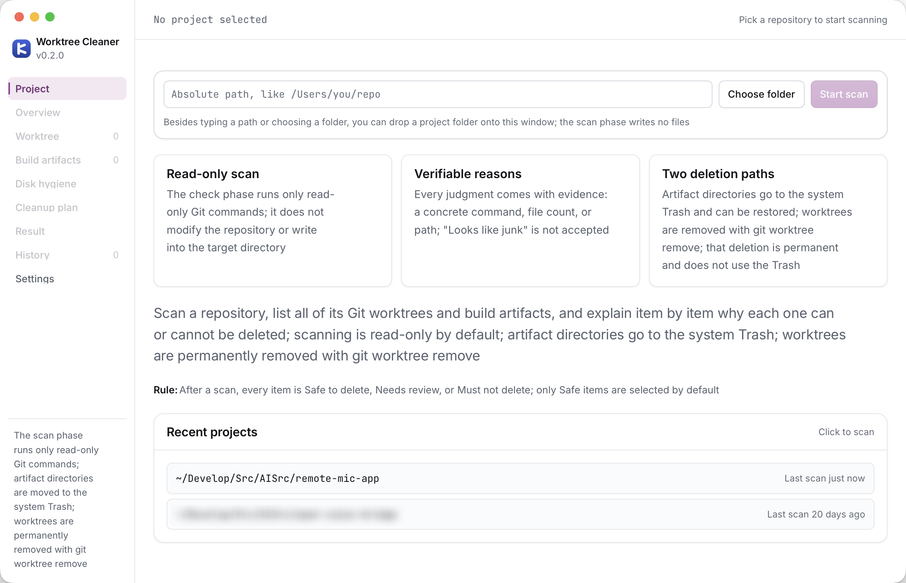
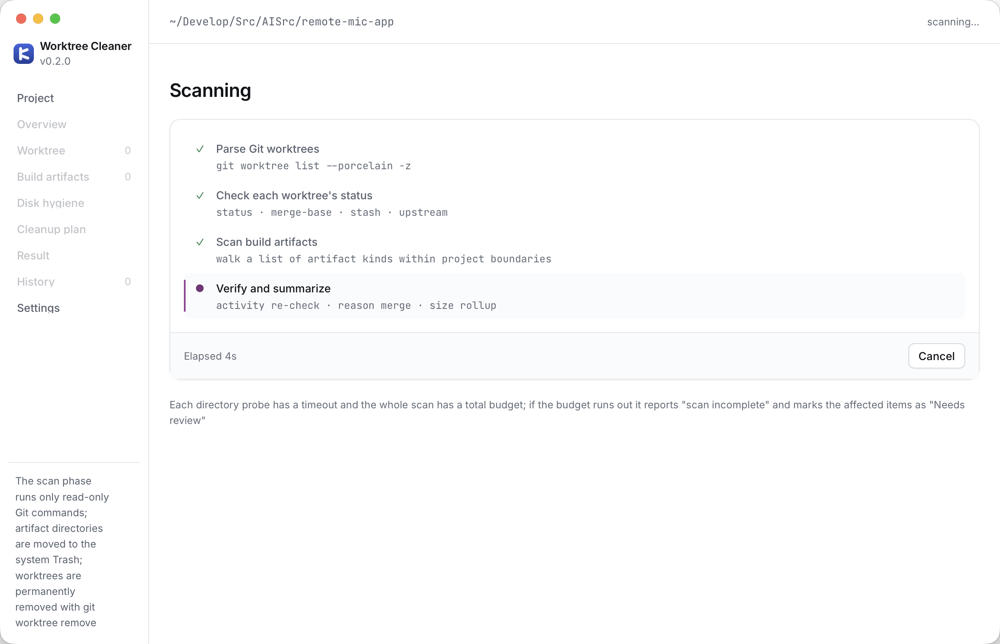
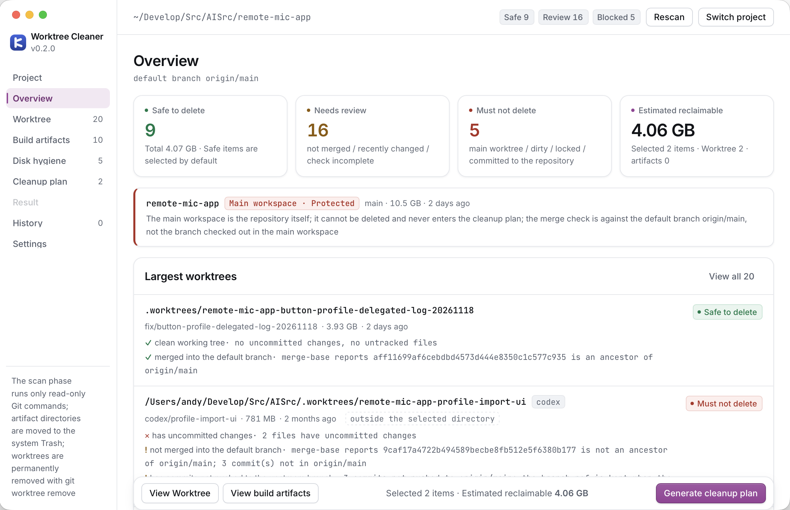
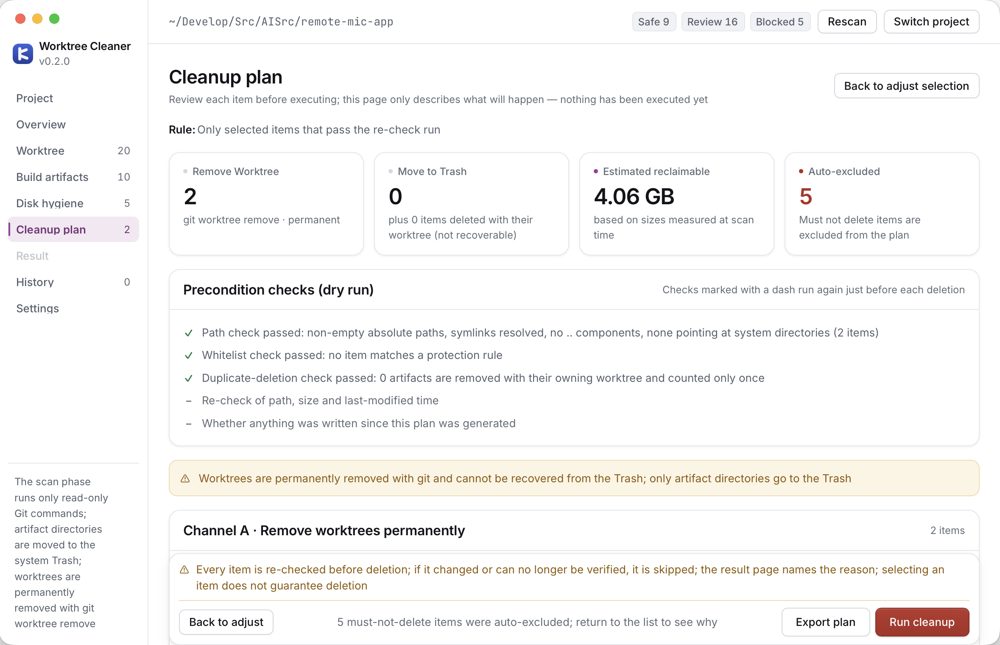

# Worktree Cleaner

A cross-agent safety audit tool for Git worktrees and build artifacts.

It scans a repository, lists every Git worktree and build-artifact directory
inside it, and explains item by item why each one can or cannot be deleted.
Scanning is read-only. Worktrees leave through Git's worktree API; artifact
directories go to the system Trash or Recycle Bin — never through a raw delete,
never through `rm -rf`.

- **Platforms**: macOS 11.3+, Windows 10 and 11
- **Stack**: Vue 3, Tauri 2, a Rust workspace, libgit2 and gix
- **License**: GPL-3.0-only

## Screenshots

The four pages, in the order a cleanup takes.



*Project — pick a repository by path, folder picker, or drag and drop.*



*Scanning — read-only, with every phase listed as it runs.*



*Overview — every worktree and artifact, with its verdict and the evidence behind it.*



*Cleanup plan — the whole plan is shown before anything is executed.*

---

## Install

Download the build for your platform from the
[Releases page](https://github.com/GetSayAll/worktree-cleaner/releases) and
install it:

| Platform | File | What happens |
|---|---|---|
| macOS (Apple silicon and Intel) | `Worktree-Cleaner_<version>_macos_universal.dmg` | Open it and drag the app into **Applications** |
| Windows | `Worktree-Cleaner_<version>_windows_x86_64-setup.exe` | Run it; it installs for the current user and needs no administrator rights |

Windows 10 and 11 include WebView2; the installer downloads the runtime when a
machine does not have it. There is no Git runtime to install and no server to run.

### Git is built in

The app links the Git implementation instead of calling a `git` program: libgit2
for repository reads and gix for worktree removal. There is no command-line tool
to install, no Xcode Command Line Tools requirement, and no child process. A fresh
Mac or Windows machine can scan and clean a repository without a developer
toolchain. Ignore rules and hooks never come from the machine; the checkout's
line-ending, case, file-mode and symlink settings are honored.

---

## What it does

- **Finds every worktree** of a project, whichever agent created it — Codex,
  Claude Code, WorkBuddy, Cursor, Aider, or a person with `git worktree add`.
  The layout of any agent's directory is never assumed; only standard Git
  metadata is read.
- **Finds independent local clones** of the selected repository by comparing the
  `origin` remote in the repository's parent folder, and can scan all of them in
  one action. Each clone remains a separate repository with its own snapshot and
  cleanup plan.
- **Removes a redundant clone as a whole.** When its main worktree is clean and
  every linked worktree is Safe, the clone can be moved to the system Trash; linked
  worktrees are removed through Git first, and any failed removal leaves the main
  clone in place.
- **Reads the state of each one**: branch, working-tree status, last commit,
  upstream, whether it is merged, whether it is locked.
- **Finds build artifacts** — `node_modules`, `target`, `dist`, `build`, and the
  other usual ones — and measures them, with a timeout per directory so a slow
  disk cannot hang the scan.
- **Judges each item**: *safe to delete*, *needs review*, or *must not delete*,
  always with the reason and the evidence that produced it. An item that cannot
  be judged is never counted as safe.
- **Audits disk hygiene** against the policy in `docs/DISK_HYGIENE.md`. It is a
  report, never an input to a deletion decision.
- **Deletes only what was confirmed**: the plan is shown in full, the executor
  re-checks every item against the current state before touching it, and a
  whitelist or a protected branch stops the run.
- **Keeps an audit log** of every deletion and every action, on the machine, in
  plain text. It is never uploaded.

### Nothing leaves the machine

The app makes exactly one network request: the check for a new version (see
below). There is no telemetry, no usage data, no crash reporting, and no
identifier of any kind.

---

## Automatic updates

The app checks the project's release page once when it starts. If a newer
version exists, the window says which version it found, and the download and the
restart are one click away in **Settings → Updates**. The check is quiet when it
fails: an app that cannot reach the release feed still works.

Every published build is signed, and the app verifies the signature against the
public key inside the application. An artifact that does not verify is refused
rather than installed.

---

## Safety rules

These are the rules the code is written around, and the tests assert them:

- Scanning never writes to the repository or to anything it scans.
- An artifact directory is deleted by moving it to the system Trash or Recycle
  Bin, never by removing it permanently.
- A worktree is removed through Git's worktree API (gix) and is permanent; the
  branch ref remains. Its metadata is pruned afterwards. No raw directory delete
  is used.
- A whole clone is never deleted in place. It can leave only through the separate
  whole-clone removal action, which removes its Safe linked worktrees through Git and
  then moves the complete clone to the system Trash. The main worktree remains
  protected from the ordinary worktree plan.
- A clean worktree may be Safe without a merged branch only when its branch ref
  remains and every ignored entry is proven disposable: a Safe artifact record, a
  verified reproducible nested checkout, Finder's `.DS_Store` metadata, or an empty
  file or directory.
- Every deletion decision is backed by a reason that names what was observed.
- An item that cannot be verified is *needs review*, never *safe*.
- The initial scan and the execution re-check use the same rules. A verdict
  difference above 10% is a scanner defect to fix; it is never turned into a
  runtime block.
- The whitelist and the protected branches are checked again at execution time,
  not only when the plan was built.

---

## Building from source

The build needs Node.js 20+ with pnpm 10, a stable Rust toolchain with
`rustfmt` and `clippy`, and the platform's own toolchain for bundling.

```bash
pnpm install
pnpm test          # the front-end tests
pnpm lint:rust     # cargo fmt --check and cargo clippy
pnpm build         # the production front end
pnpm tauri dev     # the desktop app, with hot reload
pnpm tauri build   # the installers
```

`docs/RELEASE.md` has the release process: the signing identities, the
repository secrets, the manual checks, and the order they have to happen in.

---

## Layout

```
Vue 3 interface
   ↓ Tauri IPC
Tauri 2 application host
   ↓
worktree-core
   ├── Git worktree parsing
   ├── Git status and safety checks
   ├── artifact directory scanning
   └── path validation and the audit log
```

The core is a plain Rust crate with no Tauri dependency, so the same decisions
are made in every form the project ships.

## Documentation

| File | What it holds |
|---|---|
| `docs/PRODUCT_PLAN.md` | the product design and the decision tables |
| `docs/DEV_CONTRACT.md` | the development constraints and the acceptance criteria |
| `docs/DISK_HYGIENE.md` | the disk-hygiene policy the audit implements |
| `docs/RELEASE.md` | how a release is cut, signed and published |
| `docs/WORKTREE_TRIAGE.md` | how a worktree is judged |
| `ATTRIBUTION.md` | the bundled typefaces and what they are licensed under |

## License

The code is licensed under GPL-3.0-only. See [LICENSE](LICENSE) for the full
text. The bundled typefaces are licensed separately; see
[ATTRIBUTION.md](ATTRIBUTION.md).
